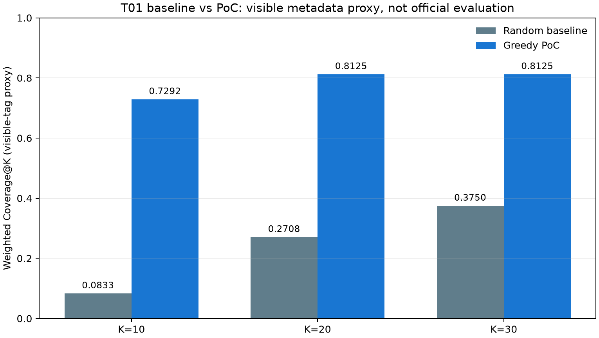

# T01 Coverage Planner — 4-slide demo

## Slide 1 — Task and protocol

- Select K clips from 120 candidates to cover 15 weighted target cells.
- Seed 42; compare random baseline with greedy weighted set cover; report K=10/20/30.
- Unknown tags do not establish coverage. Hidden verified tags are not available in the student checkout.

## Slide 2 — Results (visible-tag proxy only)

| K | Random weighted coverage | Greedy PoC weighted coverage | Hard cells covered (random → PoC) |
|---:|---:|---:|---:|
| 10 | 4/48 (0.0833) | 35/48 (0.7292) | 0/4 → 4/4 |
| 20 | 13/48 (0.2708) | 39/48 (0.8125) | 1/4 → 4/4 |
| 30 | 18/48 (0.3750) | 39/48 (0.8125) | 1/4 → 4/4 |

These are planner-visible proxy scores, not official verified-tag evaluation; PoC may be optimistically biased. Details: `reports/t01_slices_visible_proxy.md`.

## Slide 3 — Risk review and capture plan

- Three prioritized review cells and actions: C09 (`clip_108`, verify; capture backup if it fails), C13 (inspect unknown-tag candidates then capture urban/fog/night/pedestrian if none verifies), and C15 (capture alley/rain/dusk/pedestrian).
- C08 (`clip_101`) is an additional hard single-candidate risk to verify.
- Capture owner role is capture coordinator. Domain reviewer name and actual decisions are pending in `reports/t01_review_capture_plan.csv`.

## Slide 4 — Gate and evidence still required

- Pipeline decision is REWORK for C13/C15 (`UNCOVERABLE_TARGET_CELLS`); no human sign-off has occurred.
- PoC visible coverage at K=30 is 39/48 (81.25%), hard cells 4/4; holdout proxy K=6 is 0.3958 with 2/4 hard cells.
- Next: obtain visual reviewer decisions and audit evidence, official verified-tag evaluation, `pytest -q` output, and complete team contribution details before final submission.
